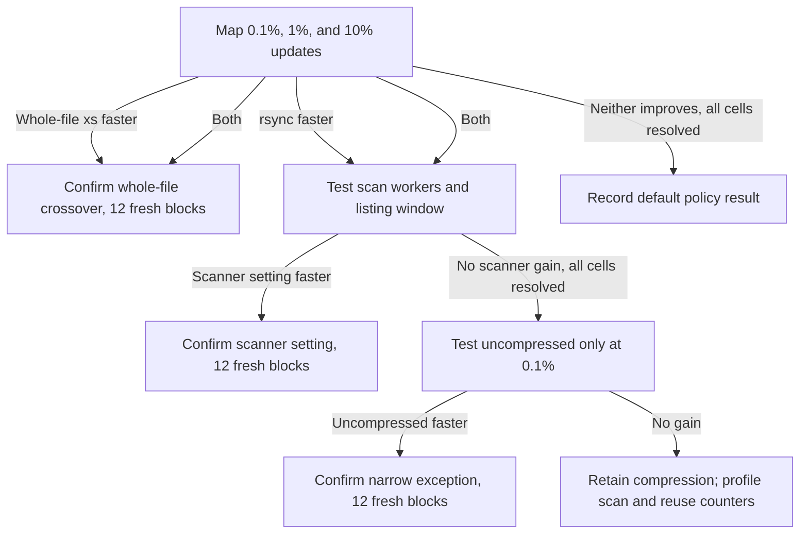

# T9/T10: incremental backups on neo ↔ freya

Question: when most files are unchanged, is backup time spent finding changes,
reusing the old backup, or moving changed data over Ethernet?

## Initial map

`IB1-incremental-map` uses `real-congress` (a real document tree) and
`mixed-bimodal` (small and large files), both directions, warm caches, eight
randomized paired blocks per cell. Its 12 cells and three arms give 288 samples.

| Arm | Flags | Purpose |
|---|---|---|
| xs-z, control | `-az` | Compressed default, including existing-file reuse |
| xs-z-whole | `-azW` | Send changed files whole; isolate the value/cost of reuse |
| rsync-z | `-az` | Compare the same backup workload with rsync |

Each sample starts with a restored scratch backup. Exactly the rounded-up
0.1%, 1%, or 10% of eligible files have up to 4 KiB edited near their middle,
with their modification times made two seconds older. These are **file
fractions**, not byte fractions. The same paths and edits are used for each arm
of a block, and the seed changes by block. Empty files and hard links are
excluded from editing. This tests existing-file modifications; it does not yet
cover additions, deletions, renames, or application-consistent snapshots.

The canonical source is immutable. Destination reset, cache conditioning,
quiet-host gates, and verification are outside the timing. The primary metric
is time to durable completion, with a 3% effect threshold. CPU, process memory,
engine counters, and wire bytes remain in the sample evidence. Every edited
file is hashed after every sample; the full tree is hashed on the first and
last blocks. Logical update rate uses selected-file bytes, not total tree size;
actual network rate must be read from the wire counters.

## Branches

Screening nodes allow one independent repeat for unresolved cells, then hold
for review. A confirmation regression also holds for review. Missing cells
cannot satisfy the initial map's “default holds” gate. Whole-file confirmation
can only select the whole-file xs arm, even if rsync was faster too. No branch
automatically changes product defaults, and this tree has no repeating filler.
Confirmation gates also require every planned direction and change fraction;
whole-file confirmation retains both corpora to catch regressions outside the
screening winner's strongest case.

The first run is preceded by a six-sample, fully verified smoke test on
`tiny-one`, exercising all three arms in both directions. T7's adaptive
compression recommendation remains in [results.md](../results.md).

## USB 2.5 Gb/s restart — 2026-10-17

T9 was stopped after 65 valid sample records when neo switched from onboard
gigabit to a USB 3 Ethernet adapter. Its partial data and tree are retained as
historical gigabit evidence. T5/T7 gigabit filler runs and the old sentinel queue
were also retired, so immutable plans cannot restart on the removed interface.

T10 repeats the design with fresh blocks and distinct experiment IDs ending in
`-2g5`. The new `neo-freya-usb-2g5` link pins neo `eth1`/`[address]` and freya
`enp10s0`/`[host]`, with a 2500 Mb/s link-speed gate and 5 ms average RTT gate.
Both directions passed route, SSH, helper, and staged-build preflight;
idle average RTT was about 1.3 ms. Earlier iperf3 measured 2.32 Gb/s neo→freya
and 2.35 Gb/s back. Old and new measurements are never pooled. The three-arm
map, change fractions, branch criteria, and conditional uncompressed follow-up
are otherwise unchanged.
