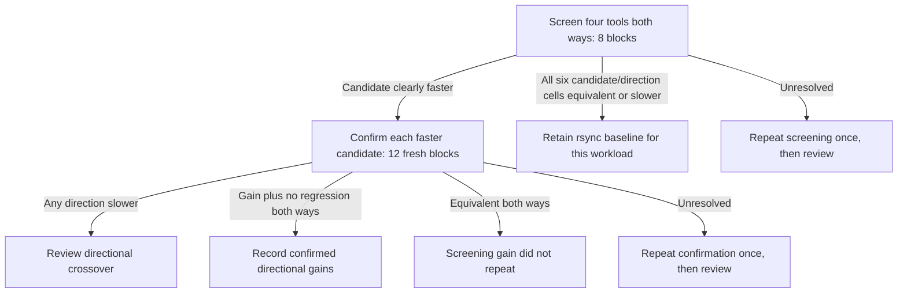

# T11: psample between the Mac and neo

Started at the user's request after corpus verification and preflight passed.
Mars and freya remain offline; their historical experiments and queues are held.
The T11 screening run is `20261018T012805Z-MN1-psample-bidir`.

## Connection and launch requirements

The Mac's OWC adapter is `en4`, manually configured as `[host]/24` with no
router. Wi-Fi remains the default route. SSH for neo now targets `[address]`
directly, retaining the verified `[host]` host-key alias and benchmark key.
The previous SSH configuration is saved in the private commissioning journal.

The Fenvi is `eth1`, MAC `00:e0:4c:68:00:0f`, USB ID `0bda:815a`, using
`cdc_ncm` on USB bus 4 at **5000 Mb/s**. Its NetworkManager profile is now
`mac-neo-direct`, with `[address]/24`, no default gateway, autoconnect enabled,
and the adapter MAC pinned. The Mac negotiates **10Gbase-T, full duplex** at MTU
1500. The previously observed 100 Mb/s negotiation has cleared.

Neo's driver reports **4294 Mb/s**. CDC NCM speed notifications use 32-bit
bits-per-second fields ([Linux USB CDC definition](https://github.com/torvalds/linux/blob/master/include/uapi/linux/usb/cdc.h));
that value is consistent with a reporting ceiling and must not be rewritten as
a measured 10,000 Mb/s observation. Preflight requires at least 10,000 Mb/s on
the Mac and uses an explicit 4000 Mb/s reported-speed floor for neo. A downgrade
to 2.5 Gb/s still fails. The physical Ethernet negotiation, USB bus rate, driver
report and measured TCP throughput remain separate provenance.

Both routes, SSH authentication/host keys, host identities, helpers and staged
xs binaries passed preflight. Neo's unsynchronized clock was seeded from the
Mac; NTP remains enabled, and clock skew must be checked again after any reboot.
The current Mac hostname is recorded rather than changing the operating system's
hostname to match an old inventory entry. Numeric-IP SSH targets use the same
verified neo identity and benchmark key as `[host]`.

Short, isolated iperf3 checks (10 measured seconds after a 2-second warm-up):

| Direction | One stream | Four streams | Four-stream retransmissions |
|---|---:|---:|---:|
| Mac → neo | 1.17 Gb/s | 1.48 Gb/s | 2755 |
| neo → Mac | 2.28 Gb/s | 2.29 Gb/s | 0 |

The asymmetry and retransmissions are recorded baseline behavior; no unverified
throughput promise follows from the 10GbE negotiation. Corpus copying was paused
during these checks, and the temporary iperf3 server was removed afterwards.

The full corpus content and metadata digest passed on neo before publication
and launch. T11 is now running on the Mac driver. Old Mac/mars and neo/freya
trees and queues remain held; neo's independent runner stays paused.

## Workload and measurement

The existing immutable psample corpus contains 711,103 files, 547,983 directories,
14 hard links and 21,045,458,323 logical file bytes. Its pinned content digest is
`1904660ff1e67214cd5629f447b04910322012598fdfb219052899f909e1ac14`.
Use byte-faithful copies and the same pinned metadata on both hosts.

`MN1-psample-bidir` compares rsync `-aH` (control), rsync `-aHz`, xs `-aH`, and xs
`-aHz`, with GNU rsync explicitly selected on the Mac. Archive mode preserves
metadata, `-H` preserves the corpus's hard links, and `-z` enables compression.
Atomic writes remain enabled. This is a fresh-copy workload in both directions;
it does not test incremental updates. The Mac initiates every SSH connection.

Eight randomized paired blocks per direction give **64 screening samples**.
The primary outcome is transfer wall time with a 5% effect threshold. Durable
completion time, wire traffic, CPU and memory remain secondary evidence: a
system-wide Mac sync should not define the transfer-time comparison. Use the
existing warm-cache protocol; do not claim the entire corpus fits in the Pi's
RAM. Full-tree verification runs on the first and last blocks. Eager scratch
cleanup limits occupied space; the initial plan budgets approximately 673 GB
of writes to each receiver, excluding retries and staging.

This establishes how a real project tree behaves when the Pi is the sender and
when it is the receiver, and whether compression helps on this hardware path.
Distinct experiment and link identities prevent pooling with Mac/mars or
neo/freya results.

## Preregistered decisions

Each of xs, xs-z and rsync-z has its own confirmation node. A candidate without
any clearly faster screening cell is skipped. Confirmations retain both
directions to catch regressions. Missing or noisy cells stay unresolved; lack
of a significant gain is never described as proof that rsync is fastest.
Rank absolute times per direction descriptively; comparisons against a common
control alone do not prove that two successful candidates differ from each
other. Report ties and uncertainty rather than selecting a universal winner.
